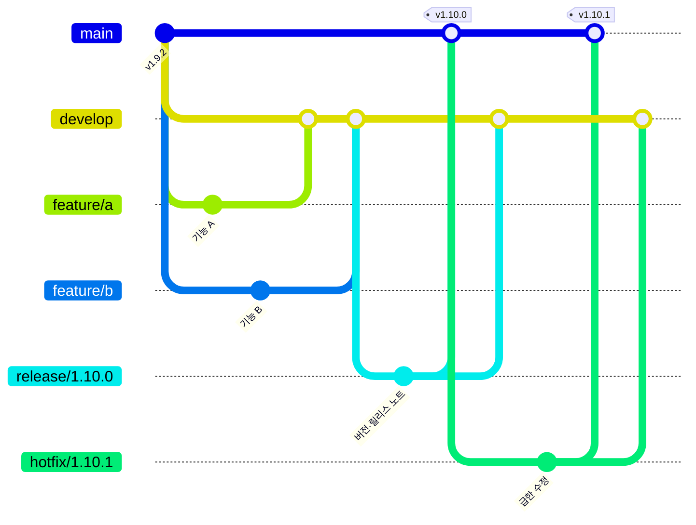

# 브랜치 전략과 작업 순서 (Git Flow)

여러 작업을 동시에 진행해도 서로 겹치지 않도록 Git Flow를 씁니다. `main`은 곧 배포본이라 직접 커밋하지 않습니다.

| 브랜치 | 만드는 곳 | 합치는 곳 | 용도 |
|---|---|---|---|
| `main` | — | — | 배포본. 병합되면 자동 배포되고 GitHub 릴리스가 생긴다 |
| `develop` | `main` | — | 다음 버전을 모으는 통합 브랜치. 기본 브랜치 |
| `feature/이름` | `develop` | `develop` | 기능·수정 하나. 문서는 `docs/이름`, 성능은 `perf/이름`도 같은 규칙 |
| `release/버전` | `develop` | `main`, `develop` | 버전을 올리고 릴리스 노트를 쓰는 곳. 버그 수정만 더한다 |
| `hotfix/버전` | `main` | `main`, `develop` | 배포본의 급한 버그를 바로 고칠 때 |

## 작업 순서

1. **기능**: `develop`에서 `feature/이름`을 만들고 PR을 `develop`으로 연다. CI(테스트·도커 빌드)가 통과하면 병합한다. 버전은 올리지 않는다.
2. **릴리스**: 내보낼 기능이 모이면 `develop`에서 `release/x.y.z`를 만들고 `backend/build.gradle`의 버전과 `release-notes/x.y.z.md`를 더한다([RELEASING.md](RELEASING.md)). PR을 `main`으로 열어 병합하면 배포·공지·GitHub 릴리스가 자동으로 된다. 그다음 `main`을 `develop`에 합친다.
3. **급한 수정**: `main`에서 `hotfix/x.y.z`를 만들어 버전(수 자리)과 노트를 올리고 `main`으로 PR → 병합 후 `develop`에도 합친다.

## 왜 이렇게 하나

- 기능마다 브랜치가 따로라 여러 기능을 동시에 만들어도 서로 덮어쓰지 않는다.
- `develop`에서 기능을 모아 시험하고, 내보낼 때만 `main`으로 보내서 `main`은 늘 배포해도 되는 상태로 남는다.
- 배포는 `main` 병합 하나로만 일어나서, 언제 무엇이 나갔는지 태그와 릴리스로 추적된다.
