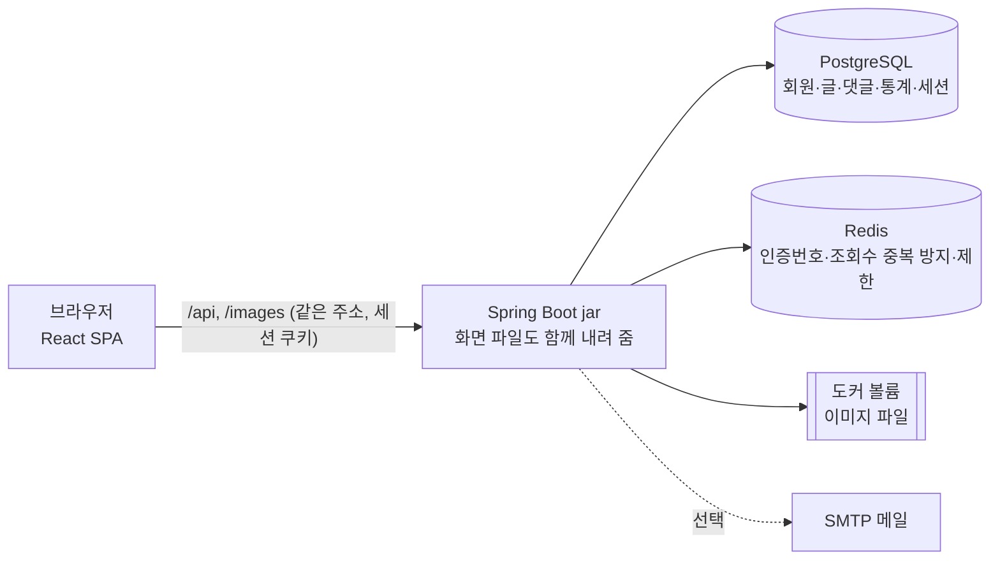
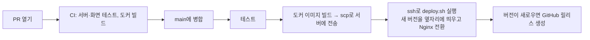

# Ylog — 누구나 블로그를 만들어 글을 쓰고 나누는 서비스

> 혼자 기획부터 배포까지 진행한 블로그 플랫폼입니다. 요구사항 문서를 먼저 쓰고(GitHub Spec Kit), 그 문서를 원천으로 서버·화면을 만들고, GitHub Actions로 자동 배포·버전 관리까지 붙였습니다.
>
> - 요구사항·설계 문서: [my-blog-home/docs](https://github.com/my-blog-home/docs) (`specs/001-blog-platform/`)
> - 현재 버전: **v1.9.2** (2026-10-13) · 릴리스 기록: GitHub Releases

## 목차

1. [한눈에 보기](#1-한눈에-보기)
2. [기술 스택과 고른 이유](#2-기술-스택과-고른-이유)
3. [구조](#3-구조)
4. [핵심 설계 결정](#4-핵심-설계-결정)
5. [데이터 모델](#5-데이터-모델)
6. [배포와 운영](#6-배포와-운영)
7. [버전과 릴리스 노트](#7-버전과-릴리스-노트)
8. [진행 기록](#8-진행-기록)
9. [트러블슈팅](#9-트러블슈팅)
10. [테스트](#10-테스트)
11. [다음 목표(안)](#11-다음-목표안)
12. [개발환경](#12-개발환경)
13. [피드백 정리와 다음 과제](#13-피드백-정리와-다음-과제)

---

## 1. 한눈에 보기

| 항목 | 내용 |
|---|---|
| 무엇 | 회원마다 블로그 하나. 글쓰기(마크다운·이미지), 주제별 둘러보기, 댓글·답글·비밀 댓글, 좋아요·북마크·구독, 블로그 관리·통계, 관리자 기능 |
| 기간 | 2026-10-08 요구사항 작성 → 같은 날 MVP·배포 → 2026-10-12까지 v1.9.0 |
| 규모 | PR 26개, 커밋 70여 개, DB 마이그레이션 16개, 서버 통합 테스트 140여 개, 화면 테스트 49개 |
| 서버 | Spring Boot 3.5 · Java 21 · PostgreSQL 16 · Redis 7 |
| 화면 | React 18 · TypeScript · Vite |
| 배포 | GitHub Actions → Docker 이미지 → SSH로 서버에서 실행, `main`에 병합하면 자동 배포 |

### 주요 기능

- **가입·로그인**: 이메일 인증번호로 가입, 세션 로그인(7일 유지), 로그인 5회 실패 시 10분 잠금, 비밀번호 찾기, 탈퇴 후 30일 재가입 대기
- **글쓰기**: 마크다운 + 툴바, 이미지 버튼·붙여넣기·끌어놓기, 코드 강조, 임시저장, 공개·비공개, 분류(끌어서 정렬, 분류별 공개 범위), 태그, 9가지 주제
- **둘러보기**: 주제 버튼, 최신순·인기순, 목록형·피드형 보기, 첫 이미지 썸네일, 지금 핫한 글 슬라이더, 실시간 인기 검색어, 이번 주 인기 블로거, 검색·태그·작성자 프로필, 다크 모드
- **소통**: 댓글·답글·비밀 댓글, 좋아요, 북마크, 블로그 구독과 구독 피드, 글·댓글 신고
- **블로그 운영**: 대시보드, 글·분류·댓글 관리(새 댓글 NEW 표시), 조회수·방문자 통계 그래프, 방문자 화면 미리보기
- **관리자**: 요약, 신고 처리(삭제·작성자 정지), 회원 정지·해제, 글·댓글 관리, 공지 쓰기
- **안내**: 공지사항·이용법, 버전별 릴리스 노트 자동 공지, 이용약관·개인정보처리방침·운영정책

---

## 2. 기술 스택과 고른 이유

요구사항 단계에서 "단순함을 고른다", "규칙과 권한은 서버가 지킨다", "숫자는 한곳에서 바꾼다"를 원칙(Spec Kit의 constitution)으로 정했고, 기술도 이 원칙에 맞춰 골랐습니다.

| 영역 | 고른 것 | 고른 이유 | 고려한 대안 |
|---|---|---|---|
| 서버 | **Spring Boot 3.5, Java 21** | 인증·검증·트랜잭션·스케줄링이 한 프레임워크에 있고, 학습 자료가 많다 | Node(Express) — 화면과 언어는 같지만 보안·트랜잭션을 직접 조립해야 함 |
| 인증 | **서버 세션 + Spring Session JDBC** | 즉시 로그아웃, 다른 기기 끊기, "마지막 사용 후 7일"을 가장 단순하게 지킨다. 서버 1대라 토큰의 장점이 없다. DB에 두면 재시작해도 로그인 유지 | JWT + 재발급 토큰 — 끊을 목록을 결국 서버가 기억해야 함 |
| 보안 | Spring Security, BCrypt, CSRF 쿠키(`X-XSRF-TOKEN`) | 같은 주소에서 화면과 API를 내려 CORS가 필요 없고, CSRF는 쿠키·헤더 방식으로 막는다 | — |
| DB | **PostgreSQL 16** | 부분 유일 색인, `on conflict`, `returning`, lateral join 등 SQL로 규칙을 지키기 쉽다 | MySQL |
| DB 변경 | **Flyway** (`V1`~`V17`) | 개발·테스트·운영 DB가 같은 순서로 만들어지고 변경 이력이 코드에 남는다. JPA 자동 생성은 끔 | JPA `ddl-auto`(운영에서 위험), Liquibase(설정이 많음) |
| 조회 | **JdbcTemplate(NamedParameter)** 위주, JPA는 회원 등 단순 엔티티만 | 목록·통계·공개 범위 조건이 복잡해 SQL을 직접 쓰는 편이 읽기 쉽고 빠르다 | 전부 JPA + QueryDSL |
| 캐시·일시 데이터 | **Redis 7** | 인증번호(10분)·재발송 제한·조회수 중복 방지(30분)·댓글 5초 제한처럼 "만료가 규칙"인 값을 TTL로 자동 처리 | DB 표 + 정리 작업 |
| 화면 | **React 18 + TypeScript + Vite** | 화면이 많고 상태(로그인, 알림 수, 테마)가 여러 곳에서 쓰여 컴포넌트 단위가 유리. Vite로 빠른 개발·빌드 | Next.js — 서버 렌더링이 필요 없고 배포가 복잡해짐 |
| 본문 | marked + DOMPurify + highlight.js | 마크다운 원문을 저장하고, 화면에서 HTML로 바꾼 뒤 허용 태그만 남겨 스크립트를 막는다 | WYSIWYG 에디터 — 범위 밖으로 둠 |
| 배포 | **Docker + GitHub Actions + SSH** | 서버에 Java를 깔지 않고 이미지 하나로 실행. 병합하면 테스트→이미지→배포→릴리스가 자동 | 수동 jar 복사 |
| 운영 DB | Crowfoot에서 발급받은 PostgreSQL | 공용 데이터베이스 안의 내 스키마를 쓰는 방식이라 `currentSchema`로 접속 | — |

---

## 3. 구조

### 3-1. 전체 구성



- 화면 빌드 결과를 jar 안에 넣어 **서버 하나가 화면과 API를 같은 주소로** 내려 줍니다. CORS 설정이 없고, 쿠키·CSRF가 단순해집니다. 화면 주소(`/posts/3` 등)는 `SpaForwardController`가 `index.html`로 넘깁니다.

### 3-2. 서버 모듈

```
backend/src/main/java/com/myblog/
├── common   설정(BlogLimits), 보안, 에러, 메일, SQL 조각(공개 범위·정지)
├── user     가입·로그인·인증번호·마이페이지·탈퇴·관리자 계정 생성
├── blog     블로그·분류·구독
├── post     글·태그·이미지·좋아요·북마크·목록 조회
├── comment  댓글·답글·비밀 댓글·신고
├── search   검색·인기 검색어
├── stats    조회수·방문자 통계
├── notice   공지·릴리스 노트·버전
└── admin    요약·신고 처리·회원 정지·글/댓글 관리·공지 쓰기
```

**부르는 방향을 한쪽으로** 정했습니다: `admin → comment·stats·search → post → blog → user`. 아래 모듈은 위 모듈을 모르기 때문에, 예를 들어 글 모듈을 고칠 때 댓글 모듈이 깨질 걱정이 줄어듭니다.

### 3-3. 화면

```
frontend/src/
├── pages/       화면 단위 (홈, 글 보기·쓰기, 블로그, 검색, 마이페이지, manage/ 블로그 관리, admin/ 관리자)
├── components/  공용 조각 (목록·썸네일·댓글·모달·서랍 메뉴·테마 버튼 등)
├── api/         fetch 래퍼(CSRF 헤더 자동), 타입
├── auth/        로그인 상태 Context
├── legal/       정책 문서(마크다운)와 운영자 정보 자리 표시
└── styles/      디자인 토큰(CSS 변수)과 다크 모드
```

---

## 4. 핵심 설계 결정

### 규칙과 권한은 서버가 지킨다
화면은 안내만 하고, 모든 권한·검증은 서버가 다시 확인합니다. 예를 들어 비공개 글이 목록·검색·인기 글·이전/다음 글 어디에서도 새지 않도록 **공개 조건 SQL을 한 곳(`PostVisibilitySql`)에 모아** 모든 조회가 같이 씁니다. 없는 글과 볼 수 없는 글은 같은 404로 답해 존재 여부도 알리지 않습니다.

### 숫자는 한곳에서 바꾼다
페이지 크기, 글자 수 제한, 이미지 크기, 비밀번호 길이 같은 숫자는 `application.yml`의 `blog.limits.*` 하나에 모으고(`BlogLimits`), 화면은 `/api/config/limits`로 같은 값을 받아 씁니다. 화면과 서버의 숫자가 어긋날 일이 없습니다.

### 계정이 있는지 알려 주지 않는다
비밀번호 찾기는 가입되지 않은 이메일에도 똑같이 "보냈어요"라고 답하고, 재발송 제한도 똑같이 올립니다. 이메일로 회원 여부를 캐낼 수 없게 했습니다.

### 이미지 저장
- 업로드 파일은 **확장자가 아니라 파일 앞부분(매직 넘버)** 으로 형식을 확인하고, 서버가 UUID로 새 이름을 붙입니다. 5MB, 글 하나에 10장까지.
- 업로드 직후에는 글에 연결되지 않은 상태로 기록하고, **글을 저장할 때 본문에 남아 있는 이미지만 그 글에 연결**합니다. 매일 새벽 정리 작업이 24시간 넘게 연결되지 않은 이미지와 DB 기록이 없는 파일(글 삭제 뒤 남은 것)을 지웁니다. 그래서 글을 고치며 이미지를 빼도, 글을 지워도 파일이 쌓이지 않습니다.
- 저장소는 `ImageStorage` 인터페이스 뒤에 두었습니다. 지금은 서버 디스크(도커 볼륨)이고, 나중에 S3·Cloudflare R2로 바꿀 때 구현체만 더하면 됩니다. (원래 MinIO를 계획했지만 공개판이 보관 처리되어 교체 가능성을 열어 둠)
- 목록 썸네일은 따로 저장하지 않고 **본문의 첫 이미지**를 씁니다(직접 올린 이미지 또는 http(s) 이미지 주소).

### 조회수·방문자
로그인 회원은 회원 번호, 비회원은 1년짜리 방문자 쿠키로 구분하고, Redis 키(`view:{글}:{방문자}` 30분, `visit:{블로그}:{방문자}:{날짜}` 자정까지)로 중복을 막습니다. 블로그 주인은 세지 않고, 날짜는 한국 시간 기준입니다.

### 성능: 실시간 인기 검색어 캐싱 (v1.9.1)

**문제** — 첫 화면 오른쪽의 "실시간 인기 검색어"는 화면이 열릴 때마다, 그리고 열려 있는 동안 1분마다 서버에 요청합니다. 서버는 요청마다 최근 24시간 검색 기록(`search_log`)을 **두 번 집계**했습니다(지금 순위, 순위 변동 비교용 1시간 전 순위). 그런데 이 순위는 매 순간 바뀔 필요가 없습니다. 방문자가 늘수록 DB가 같은 계산을 계속 반복하는 구조였습니다.

**해결** — 계산한 순위를 Redis에 담아 두고 그동안은 DB를 보지 않습니다(`PopularKeywordCache`).
- 순위는 10분 동안 "새 값"으로 쓰고(`blog.cache.popular-keywords-ttl`), 20분까지는 "조금 지난 값"으로 남겨 둡니다.
- 새 값이 끝나면 **한 요청만 잠금(`SET NX`)을 잡고 다시 계산**하고, 그동안 다른 요청은 조금 지난 값을 받습니다. 캐시가 끝나는 순간 요청이 한꺼번에 DB로 몰리는 캐시 스탬피드를 막기 위해서입니다.
- Redis가 멈추면 캐시 없이 DB에서 바로 계산해 기능은 그대로 동작합니다(확인함).
- 화면의 "HH:mm 기준" 표시가 계산 시각을 보여 주므로, 10분 간격이어도 사용자가 언제 기준인지 알 수 있습니다.

**측정** — 같은 조건에서 바꾸기 전과 후를 비교했습니다. 로컬 Mac, 측정용 DB에 최근 25시간 검색 기록 10만 건(검색어 2,000개, 인기 있는 단어에 몰리게 생성), `ab`로 인기 검색어 API에 2,000번 요청(동시 20개).

| | 캐싱 전 | 캐싱 후 |
|---|---|---|
| 처리량 | 초당 10.7건 | 초당 3,971건 (약 370배) |
| 응답 시간 중간값 / 95% (동시 20) | 1,872ms / 1,946ms | 5ms / 8ms |
| 응답 시간 평균 (한 번에 하나씩) | 458ms | 0.5ms |
| 2,000번 요청 동안 `search_log` 집계 | 4,014번 | 0번 |

캐시가 끝나 다시 계산하는 요청 하나만 DB를 거치고(측정 때 약 0.1초), 나머지는 Redis에서 바로 답합니다.

### 성능: 지금 핫한 글·이번 주 인기 블로거 (v1.9.2)

**문제** — 첫 화면을 열 때마다 "지금 핫한 글"과 "이번 주 인기 블로거"를 새로 계산했습니다. 측정해 보니 인기 검색어만큼은 아니어도 요청 하나에 수십 ms가 걸렸습니다.

**원인 찾기** — 처음에는 글마다 좋아요·댓글 수를 따로 세는 것(N+1)을 의심해 한 번에 세는 쿼리로 바꿨는데, **오히려 느려졌습니다**(평균 약 17ms → 25ms). 그래서 `EXPLAIN ANALYZE`로 실행 계획을 보니 진짜 병목은 따로 있었습니다.
- 글마다 좋아요·댓글 수 세기: 색인만 읽는 조회라 글 6,600개에도 약 26ms로 생각보다 쌌습니다.
- **날짜 조건**: "한국 날짜로 N일 안"을 글마다 `published_at`을 날짜로 바꿔 비교해서 색인을 못 쓰고 글 표 전체(3만 건)를 읽었습니다.
- **가장 최근 글 찾기**: `max(published_at)`를 구하려고 글 표 전체를 한 번 더 읽었습니다(약 20ms).

**해결**
1. 날짜 조건을 "그 날짜의 한국 자정 이후"라는 **시각 하나와 비교**하게 바꾸고, 가장 최근 글은 `order by published_at desc limit 1`로 찾게 했습니다. 공개 글의 올린 시각에 부분 색인을 더했습니다(V17 `ix_post_public_published`). 결과는 바꾸기 전과 똑같은지 주제별로 비교해 확인했습니다.
2. 계산 결과를 **주제마다 1분 동안 Redis에 캐싱**합니다(`blog.cache.home-rankings-ttl`). 좋아요·댓글은 1분 안에 반영돼 거의 바로 바뀌는 느낌을 유지합니다. 인기 검색어와 같은 캐시 도구(`ShortCache`: 갱신은 한 요청만, Redis가 멈추면 바로 계산)를 공용으로 만들어 함께 씁니다.

**측정** — 로컬 Mac, 측정용 DB(블로그 1,000개, 글 3만, 좋아요 약 15만, 댓글 6만), `ab`로 1,000번 요청(동시 20개). 단계마다 같은 데이터로 쟀습니다.

| 지금 핫한 글 | 처음 | 쿼리·색인 개선 | + 1분 캐싱 |
|---|---|---|---|
| 처리량 | 초당 127건 | 초당 228건 | 초당 3,127건 (약 25배) |
| 응답 중간값 (동시 20) | 142ms | 86ms | 6ms |
| 응답 평균 (하나씩) | 34ms | 20ms | 1.0ms |

| 이번 주 인기 블로거 | 처음 | 쿼리·색인 개선 | + 1분 캐싱 |
|---|---|---|---|
| 처리량 | 초당 203건 | 초당 402건 | 초당 6,707건 (약 33배) |
| 응답 중간값 (동시 20) | 96ms | 48ms | 3ms |
| 응답 평균 (하나씩) | 26ms | 12ms | 0.8ms |

캐싱 후에는 1,000번 요청 동안 글·좋아요·댓글 표를 한 번도 읽지 않았습니다. 짐작으로 고치기보다 **실행 계획과 측정으로 원인을 확인한 뒤 고친** 사례입니다.

### 무중단 배포 (블루-그린)

**문제** — 배포 스크립트가 옛 앱 컨테이너를 지우고 새로 띄웠습니다. 새 버전이 켜질 때까지 사이트가 멈췄고, 새 버전이 켜지지 않으면 사이트가 내려간 채로 남았습니다. 서버에서 0.2초마다 접속하며 실제 배포 2번을 재 보니 **7.5초, 8.6초** 동안 접속이 거부됐습니다.

**해결** — 앞에 Nginx를 두고 앱 자리를 두 개(blue/green)로 나눴습니다(`deploy/deploy.sh`).
1. 쓰지 않는 자리에 새 버전을 띄우고, 응답할 때까지 기다립니다. 그동안 옛 버전이 계속 요청을 받습니다.
2. 응답하면 Nginx 설정을 새 자리로 바꿔 `nginx -s reload`합니다. reload는 처리 중인 요청을 끊지 않습니다.
3. 옛 컨테이너는 graceful shutdown(`server.shutdown: graceful`)으로 처리 중인 요청을 마치고 꺼집니다.
4. 새 버전이 3분 안에 켜지지 않으면 새 컨테이너만 지우고 배포를 실패로 끝냅니다. 사이트는 옛 버전으로 계속 동작합니다.

Nginx 이미지는 GitHub Actions가 앱 이미지와 함께 서버로 보내서, 서버가 인터넷에서 이미지를 받지 않아도 됩니다. 두 버전이 잠깐 같은 DB를 쓰므로 표를 바꿀 때는 옛 버전이 깨지지 않게 더하는 방향으로 나눠서 바꿉니다.

**측정** — 같은 방법(서버에서 0.2초마다 `/api/config/version` 요청)으로 바꾼 뒤의 배포 3번을 쟀습니다.

| 배포 | 접속 실패 | 멈춘 시간 |
|---|---|---|
| 바꾸기 전 (2번) | 36번, 40번 | 7.5초, 8.6초 |
| 새 방식으로 넘어가는 첫 배포 (1번, 포트를 Nginx에 넘기는 순간) | 3번 | 약 0.6초 |
| 블루-그린 배포 (2번) | **0번** (약 3,900번 요청 중) | **0초** |

### 관리자 계정은 가입으로 만들 수 없다
가입으로 만든 계정은 항상 일반 회원입니다. 관리자는 배포 시크릿 `ADMIN_EMAIL`·`ADMIN_PASSWORD`가 있을 때 서버가 켜지면서 한 번만 만들고, 이미 있으면 아무것도 바꾸지 않습니다. 비밀번호가 코드나 Git에 남지 않습니다.

### 탈퇴
탈퇴하면 블로그와 글은 지우고, 남의 글에 단 댓글은 "탈퇴한 회원"으로 남깁니다. 같은 이메일은 30일 뒤부터 다시 가입할 수 있습니다(악용 방지).

---

## 5. 데이터 모델

마이그레이션 `V1`~`V17`이 만드는 주요 표입니다.

| 표 | 내용 |
|---|---|
| `member` | 회원(이메일·닉네임·BCrypt 비밀번호·역할·로그인 실패 횟수·잠금·프로필 색·탈퇴 시각) |
| `blog`, `category`, `topic` | 블로그(회원당 1개), 분류(순서·공개 범위·소개글), 주제(9개) |
| `post`, `tag`, `post_tag`, `post_image` | 글(상태: 임시저장/발행, 공개 범위, 조회수), 태그, 이미지 기록 |
| `comment`, `post_like`, `bookmark`, `subscription` | 댓글(답글·비밀), 좋아요, 북마크, 블로그 구독 |
| `report`, `suspension` | 신고(글·댓글, 처리 상태), 회원 정지 이력 |
| `daily_stats`, `post_daily_views` | 블로그별·글별 일별 조회 통계 |
| `search_log` | 인기 검색어 집계(2일 보관) |
| `notice` | 공지·이용법·릴리스 노트(`release_version`, 숨김 여부) |
| `spring_session*` | 로그인 세션 |

ERD와 표마다의 규칙은 docs 저장소의 `data-model.md`에 있습니다.

---

## 6. 배포와 운영



- **CI** (`ci.yml`): PR마다 서버 통합 테스트(PostgreSQL·Redis 서비스 컨테이너)와 화면 테스트, 도커 빌드를 돌립니다.
- **배포** (`deploy.yml`): `main`에 병합되면 자동으로 테스트 → 이미지 빌드 → 서버로 전송 → `deploy/deploy.sh`가 **무중단(블루-그린)** 으로 바꿔 띄웁니다. 바깥 포트 8330은 Nginx(`ylog-proxy`)가 열고 앱은 `ylog-app-blue`/`ylog-app-green` 중 한 자리에서 돕니다(이미지 볼륨 `ylog-images`, Redis는 같은 도커 네트워크). 손으로 다시 돌릴 때는 Actions의 Run workflow. → [4. 핵심 설계 결정](#4-핵심-설계-결정)의 무중단 배포
- **브랜치** : 기능은 `develop`으로, 배포는 `release`·`hotfix`를 `main`으로 병합할 때만 일어납니다([CONTRIBUTING.md](CONTRIBUTING.md)).
- **설정은 전부 GitHub 시크릿**에서 환경변수로 넘깁니다(DB 접속, SSH, 관리자 계정, 메일). 값은 코드·로그에 남기지 않습니다.
- **운영 DB**는 Crowfoot에서 발급받은 PostgreSQL입니다. 공용 데이터베이스 안의 내 스키마를 쓰기 때문에 `currentSchema=<스키마>`로 접속하고, Flyway도 그 스키마에 표를 만듭니다.
- 메일 계정을 정하기 전까지는 `MAIL_MODE=log` + `SHOW_CODE_ON_SCREEN=true`(가입 화면에 인증번호 표시)로 시험 운영 중입니다. 정식 오픈 전에 반드시 끕니다.

자세한 환경변수는 [DEPLOY.md](DEPLOY.md)를 봅니다.

---

## 7. 버전과 릴리스 노트

`주.부.수` 버전을 씁니다(새 기능은 부, 수정은 수). 버전은 `backend/build.gradle` 한 곳에만 있고, `build-info`로 서버가 자기 버전을 압니다.

- **버전은 릴리스 때 한 번에 올립니다.** 기능 PR(`feature/*` → `develop`)은 버전을 올리지 않고, 기능이 모이면 `release/x.y.z` 브랜치에서 버전과 그 버전의 릴리스 노트를 더해 `main`으로 내보냅니다. 급한 버그는 `hotfix/x.y.z`에서 수 자리를 올립니다. (v1.9.2까지는 PR마다 버전을 올렸습니다.)

- `backend/src/main/resources/release-notes/{버전}.md`에 노트를 쓰면, 배포된 서버가 켜질 때 **공지사항에 "업데이트" 공지로 한 번만** 올립니다(`release_version` 유일 색인, 다시 배포해도 중복 없음).
- 화면 바닥글에 현재 버전과 릴리스 노트 링크가 보이고, 배포 워크플로가 `v{버전}` GitHub 릴리스를 만듭니다.
- 공지 목록에서는 공지·이용법이 위에 고정되고 업데이트는 그 뒤에 최신순으로 옵니다.
- 업데이트 공지는 버전마다 하나입니다. 노트 파일을 지우면 그 버전의 공지는 지우지 않고 숨깁니다(파일을 되살리면 다시 보임).

자세한 절차는 [RELEASING.md](RELEASING.md)를 봅니다.

---

## 8. 진행 기록

### 0단계: 요구사항 (2026-10-08)
- GitHub **Spec Kit**으로 constitution(원칙 6가지) → spec(사용자 시나리오 US1~US8, 기능 요구사항) → plan·research(기술 결정 R-01~R-17) → data-model → tasks 순서로 문서를 먼저 썼습니다.
- 이후 pblog 시안에서 가져온 기능을 FR-058~087로 spec에 더했습니다.

### 1단계: MVP와 첫 배포 (2026-10-08, v1.0.0까지)

| 단계 | 내용 |
|---|---|
| MVP | US1~US3(가입·로그인, 블로그·분류·글쓰기, 목록·검색) 서버와 화면 |
| US4~US8 | 댓글·좋아요, 마이페이지·비밀번호 찾기·탈퇴, 블로그 관리·새 댓글·통계, 태그·이미지·신고 |
| 디자인 | pblog 시안 + 요즘것들 느낌으로 Ylog 디자인 토큰 적용 |
| pblog 기능 | 주제·임시저장·분류 공개 범위, 답글·비밀 댓글·구독·햄버거 메뉴, 핫한 글·인기 검색어·인기 블로거·공지·작성자 프로필 |
| #1~#3 | GitHub Actions 자동 배포, Crowfoot DB 스키마 접속 |
| #4 | 비밀번호 8~10자 → 8자 이상 |
| #5 | 관리자(신고 처리·회원 정지·공지), 탈퇴 30일 재가입 대기, 방문자 화면 미리보기 |
| #6 | 분류 끌어서 정렬, 내 블로그, 프로필 메뉴, 페이지 번호, 코드 강조, 메타 태그, 접근성 |
| #7 | **v1.0.0** 버전·릴리스 노트 자동 공지·GitHub 릴리스 |

### 2단계: 다듬기 (2026-10-12, v1.0.1~v1.9.0)

| 버전 | PR | 내용 |
|---|---|---|
| 1.0.1 | #8 | 햄버거 메뉴에 공지사항 |
| 1.1.0 | #9 | 7일 안의 글은 "N시간 전"으로 표시 |
| 1.2.0 | #10 | 북마크 |
| 1.2.1 | #11 | 주제 '문화·리뷰' 정리(글은 '취미'로 이동하는 마이그레이션) |
| 1.3.0 | #12 | 이용약관·개인정보처리방침·운영정책, 가입 시 동의 |
| 1.3.1 | #13 | 홈 오른쪽 영역의 따로 스크롤 제거 |
| 1.3.2 | #14 | 주제 버튼 한 줄에 5개씩 |
| 1.4.0 | #15, #16 | 메인 글 목록을 목록형으로, 첫 이미지 썸네일(외부 이미지 주소 포함) |
| 1.4.1 | #17 | 목록 위 글 수 표시 제거 |
| 1.5.0 | #18 | 앨범형 보기 (1.6.0에서 피드형으로 교체) |
| 1.5.1 | #19 | 공지·이용법 고정, 업데이트는 그 뒤로 |
| 1.6.0 | #20 | 목록형/피드형 보기 전환(브라우저에 기억) |
| 1.7.0 | #21 | 관리자 글·댓글 관리 |
| 1.7.1 | #22 | 비밀번호 특수문자로 키보드 기호 모두 허용 |
| 1.8.0 | #23 | 다크 모드(기기 설정 따름, 첫 그림 전 적용으로 깜빡임 없음) |
| 1.9.0 | #24 | 홈 오른쪽 내 정보 카드 |
| 1.9.1 | #29 | 실시간 인기 검색어 Redis 캐싱(처리량 약 370배) |
| 1.9.2 | #30 | 핫한 글·인기 블로거 쿼리 개선(색인)과 주제별 1분 캐싱(처리량 약 25~33배) |

### 정리
- #25: 하루에 쌓인 1.0.1~1.9.0 업데이트 공지 16개를 "업데이트 모음" 공지 하나로 합침(옛 공지는 지우지 않고 숨김, 버전 그대로)
- #26: 이 README

---

## 9. 트러블슈팅

| 문제 | 원인 | 해결 |
|---|---|---|
| 배포 후 `database "..." does not exist` | Crowfoot DB는 공용 데이터베이스 안의 **스키마**를 주는데, 스키마 이름을 데이터베이스 이름으로 접속함 | 접속 주소를 `/{공용 DB}?currentSchema={스키마}`로 바꾸고 `DB_SCHEMA` 시크릿을 더함 (#3) |
| 화면 파일(`/assets/*.js`)이 HTML로 내려옴 | SPA 주소를 `index.html`로 넘기는 규칙이 `/assets`까지 잡음 | 정적 파일 경로를 넘김 규칙에서 뺌 |
| 바뀐 비밀번호 규칙이 배포 화면에 안 보임 | 브라우저 캐시 | 강력 새로고침(Cmd+Shift+R)으로 확인, 빌드 파일 이름에 해시가 붙는지 점검 |
| v1.4.0 병합 후 배포가 멈춤 | 테스트가 "공지 첫 페이지에 1.0.0 노트가 있다"를 확인했는데, 노트가 늘어 다음 페이지로 밀림 | 테스트가 **지금 버전의 노트**를 보게 고침(#16). 데이터 양에 따라 깨지는 테스트를 피하는 교훈 |
| 관리자 계정이 안 만들어짐 | 시크릿 비밀번호에 규칙이 허용하지 않던 기호(마침표 등)가 있었음. 서버 로그로 원인 확인(값은 출력하지 않음) | 특수문자를 키보드 ASCII 기호 전체로 넓힘(#22). 일반 가입자도 같은 문제를 겪을 수 있었음 |
| 인기 검색어 API가 요청마다 느림(동시 20개일 때 응답 약 1.9초) | 요청마다 최근 24시간 검색 기록을 두 번 집계 | 순위를 Redis에 10분 캐싱하고 갱신은 한 요청만(v1.9.1). 처리량 약 370배 → [4. 핵심 설계 결정](#4-핵심-설계-결정) |
| 첫 화면의 핫한 글·인기 블로거가 요청마다 수십 ms | N+1을 의심했지만 실행 계획을 보니 날짜 조건이 색인을 못 써 글 표 전체를 읽는 게 병목 | 시각 비교 + 부분 색인으로 약 2배, 주제별 1분 캐싱으로 약 25~33배(v1.9.2) → [4. 핵심 설계 결정](#4-핵심-설계-결정) |
| 배포할 때마다 사이트가 약 8초 멈춤, 새 버전이 안 켜지면 내려간 채로 남음 | 옛 컨테이너를 지우고 새로 띄우는 배포 | Nginx + 블루-그린, 응답 확인 후 전환, graceful shutdown. 배포 중 접속 실패 0번 → [4. 핵심 설계 결정](#4-핵심-설계-결정) |
| 로컬 테스트의 Flyway 검증 실패 | 테스트 DB에 예전 마이그레이션 기록이 남음 | 테스트 스키마를 지우고 다시 만듦 |
| 댓글 관리를 열면 NEW 표시가 바로 사라짐 | 목록 조회와 읽음 처리가 한 요청 | 읽음 처리를 별도 요청으로 분리 |
| 글쓰기 화면이 요청을 반복 | 로그인 확인 함수가 렌더마다 새로 만들어져 effect가 계속 실행 | 함수를 고정(`useCallback`) |

---

## 10. 테스트

```bash
cd backend && ./gradlew test     # 통합 테스트: 로컬 PostgreSQL(myblog_test)과 Redis
cd frontend && npm test          # Vitest
```

- 서버는 **실제 PostgreSQL·Redis에 붙는 통합 테스트** 위주입니다(MockMvc). constitution이 자동 테스트를 요구한 네 가지 — 권한, 비공개 글 노출, 인증번호·로그인 잠금, 계정 존재 비노출 — 를 먼저 쓰고, 댓글·좋아요·태그·이미지·신고·관리자·통계·공지 규칙을 더했습니다.
- 화면은 비밀번호 규칙 안내, 마크다운 스크립트 차단, 페이지 번호, 목록·피드 렌더링, 상대 시간, 테마 저장 같은 규칙을 Vitest로 확인합니다.
- PR마다 CI에서 둘 다 돌고, 실패하면 배포되지 않습니다.

---

## 11. 다음 목표(안)

| 묶음 | 내용 |
|---|---|
| v2.0 정식 오픈 준비 | HTTPS, 메일 발송(인증번호), 이미지 압축(가로 1600px·WebP), 정책 페이지 빈칸(운영자 정보) 채우기, 약관 동의 기록 저장, 시험 모드(`SHOW_CODE_ON_SCREEN`) 끄기 |

---

## 12. 개발환경

### 도구와 버전

| 구분 | 도구 | 버전 | 메모 |
|---|---|---|---|
| 서버 | Java (Temurin) | 21 | |
| | Spring Boot | 3.5.6 | |
| | Gradle | 8.14 (wrapper) | `backend/gradlew`를 쓰므로 따로 설치하지 않아도 된다 |
| 화면 | Node.js | 22 (20 이상) | CI도 22 |
| | Vite / TypeScript | 6 / 5.8 | |
| | Vitest | 3 | 화면 테스트 |
| 데이터 | PostgreSQL | 16 | 개발 `myblog`, 테스트 `myblog_test` |
| | Redis | 7 | 개발 0번 DB, 테스트 15번 DB |
| 배포 | Docker, GitHub Actions | | 서버에서는 Nginx 1.27 + 앱 컨테이너(블루-그린) |
| 문서 | GitHub Spec Kit | 1.1 | 요구사항 문서는 [docs 저장소](https://github.com/my-blog-home/docs) |

### 폴더

```
blog-app/
├── backend/                 Spring Boot (Gradle)
│   ├── src/main/java/com/myblog/   기능 모듈 (3-2 참고)
│   ├── src/main/resources/
│   │   ├── application.yml         공통 설정과 숫자(blog.limits.*)
│   │   ├── application-dev.yml     로컬 개발 (DB·Redis 주소, 인증번호는 로그로)
│   │   ├── application-prod.yml    배포 (모든 값은 환경변수)
│   │   ├── db/migration/           Flyway V1~
│   │   └── release-notes/          버전별 릴리스 노트
│   └── src/test/                   통합 테스트 (application-test.yml)
├── frontend/                React + Vite (3-3 참고). vite.config.ts가 /api·/images를 서버로 넘긴다
├── deploy/deploy.sh         서버에서 도는 무중단 배포 스크립트
├── .github/workflows/       ci.yml(PR 검사), test.yml(공용 테스트), deploy.yml(main 배포·릴리스)
├── Dockerfile               화면 빌드 → 서버 빌드(화면 포함 jar) → 실행 이미지
├── docker-compose.yml       개발용 PostgreSQL·Redis (Docker를 쓸 때)
├── run.sh / build.sh        한 번에 켜기 / 배포용 jar 만들기
└── CONTRIBUTING.md · RELEASING.md · DEPLOY.md   브랜치 전략 · 버전 · 배포
```

### 처음 준비

```bash
# macOS(Homebrew) 예시
brew install openjdk@21 node postgresql@16 redis
brew services start postgresql@16
brew services start redis

# 개발용·테스트용 DB와 계정 (로컬 전용 값)
createuser -s myblog
psql -d postgres -c "ALTER USER myblog PASSWORD 'myblog';"
createdb -O myblog myblog
createdb -O myblog myblog_test
```

Docker를 쓴다면 PostgreSQL·Redis 설치 대신 `docker compose up -d` 후 `myblog_test` DB만 만듭니다.

### 실행

한 번에 켜기(화면을 빌드해 서버 하나로 띄움):

```bash
./run.sh        # → http://localhost:8080
./run.sh stop
```

화면과 서버를 따로 켜서 개발하기(화면 코드를 고치면 바로 반영됨):

```bash
cd backend && ./gradlew bootRun                # 서버 http://localhost:8080 (프로필 dev)
cd frontend && npm install && npm run dev      # 화면 http://localhost:5173 → /api, /images는 8080으로
```

- 가입 인증번호는 메일 대신 가입 화면(시험 모드 상자)과 서버 로그(`run.sh`면 `.run/server.log`)에 나옵니다.
- DB 표는 서버가 켜질 때 Flyway가 만들고 바꿉니다. 표를 바꿀 때는 새 `V번호__설명.sql`을 더하고 옛 파일은 고치지 않습니다.

### 테스트

```bash
cd backend && ./gradlew test     # 통합 테스트: myblog_test DB와 Redis 15번 DB (테스트 전마다 비움)
cd frontend && npm test          # Vitest
cd frontend && npx tsc -b        # 타입 검사
```

PR을 열면 GitHub Actions가 같은 테스트와 도커 빌드를 돌립니다.

### 설정과 환경변수

- 로컬 개발은 `application-dev.yml`의 기본값으로 돌아가서 따로 정할 값이 없습니다.
- 배포 서버는 모든 값을 환경변수로 받고, 값은 GitHub 시크릿에만 둡니다(저장소에 올리지 않음). 이름과 뜻은 [DEPLOY.md](DEPLOY.md)에 있습니다: `DB_ADDRESS`, `DB_PORT`, `DB_NAME`, `DB_SCHEMA`, `DB_USERNAME`, `DB_PASSWORD`, `SSH_*`, `MAIL_MODE`, `SMTP_*`, `SHOW_CODE_ON_SCREEN`, `COOKIE_SECURE`, `ADMIN_EMAIL`, `ADMIN_PASSWORD`.

### 데이터가 있는 곳

| 데이터 | 위치 |
|---|---|
| 회원, 블로그, 글, 댓글, 통계, 로그인 세션 | PostgreSQL |
| 인증번호, 재발송 제한, 조회수 중복 방지, 댓글 5초 제한, 순위 캐시 | Redis (자동 만료) |
| 이미지 파일 | 로컬 `~/.myblog/images`, 서버는 도커 볼륨 `ylog-images` |

### 작업 흐름

`develop`에서 `feature/이름` 브랜치를 만들어 작업하고 `develop`으로 PR을 엽니다. 내보낼 때는 `release/x.y.z`에서 버전을 올려 `main`으로 병합합니다(자동 배포). 자세한 건 [CONTRIBUTING.md](CONTRIBUTING.md).

---

## 13. 피드백 정리와 다음 과제

강사님께 받은 피드백을 주제별로 정리했습니다. 이미 이 프로젝트에서 한 것은 해당 섹션을 적고, 나머지는 다음에 할 일로 둡니다.

### Git 브랜치 전략과 병렬 작업
- `main`에서 바로 고치면 두 작업이 같은 파일을 건드릴 때 겹친다. 기능마다 브랜치를 따로 만들면 여러 작업을 동시에(병렬로) 진행하고 따로 병합할 수 있다.
- **처음(PR #1~#31):** 작업마다 브랜치를 만들어 `main`으로 바로 PR하는 방식(GitHub Flow에 가까움). 병합할 때마다 배포됐다.
- **완료:** Git Flow 적용. `develop`에 기능을 모으고 `release`·`hotfix` 브랜치에서만 버전을 올려 `main`으로 내보낸다. CI는 `develop`·`main`으로 가는 PR마다, 배포는 `main` 병합 때만 → [CONTRIBUTING.md](CONTRIBUTING.md)
- **다음:** 충돌 해결, rebase와 merge 차이 같은 Git 사용법을 익힌다.

### 버전 관리
- **지금:** `주.부.수` 버전, 버전마다 릴리스 노트, 배포 때 공지·GitHub 릴리스 자동 생성 → [7. 버전과 릴리스 노트](#7-버전과-릴리스-노트)

### 배포 과정과 CI/CD
- 코드를 올리면 테스트 → 빌드 → 배포까지 이어지는 **하나의 파이프라인**을 만들고, 그 과정을 설명할 수 있어야 한다.
- **지금:** `.github/workflows/`의 `ci.yml`(PR 검사), `test.yml`(공용 테스트), `deploy.yml`(이미지 빌드·서버 전송·배포 스크립트 실행·릴리스)과 `deploy/deploy.sh` → [6. 배포와 운영](#6-배포와-운영)
- **완료:** 무중단(블루-그린) 배포. 배포 중 멈춤 7.5~8.6초 → 0초, 새 버전이 안 켜지면 옛 버전이 계속 서비스 → [4. 핵심 설계 결정](#4-핵심-설계-결정)
- **다음:** 파이프라인 단계별로 걸리는 시간을 정리하고, 문제가 생긴 버전을 이전 이미지로 바로 되돌리는 롤백을 더한다.

### 파일 업로드 처리
- 파일을 어디에 두고, 어떻게 검사하고, 언제 지울지를 정해야 한다.
- **지금:** 매직 넘버로 형식 확인, UUID 이름, 글 저장 때 연결, 매일 정리 작업, `ImageStorage`로 저장소 교체 가능 → [4. 핵심 설계 결정](#4-핵심-설계-결정)의 이미지 저장
- **다음:** 업로드 때 크기 줄이기·WebP 압축, 사용자가 늘면 S3·Cloudflare R2 같은 외부 저장소로 옮기기.

### 소셜 로그인
- **다음:** 카카오·구글·네이버 로그인을 OAuth 2.0으로 붙여 본다(Spring Security OAuth2 Client). 기존 이메일 계정과 같은 이메일일 때 어떻게 연결할지 정한다.

### 캐싱: 자주 조회되는 것
- "실시간 인기 검색어"는 실제로 매 순간 바뀌는 게 아니라 일정 간격으로 다시 계산해도 된다. 이런 값을 캐싱하면 DB 부담을 줄일 수 있다.
- **완료(v1.9.1):** 인기 검색어 순위를 Redis에 10분 캐싱하고, 캐시가 끝날 때는 한 요청만 다시 계산하게 했다. 처리량 초당 10.7건 → 3,971건, DB 집계 4,014번 → 0번 → [4. 핵심 설계 결정](#4-핵심-설계-결정)의 "성능: 실시간 인기 검색어 캐싱"
- **완료(v1.9.2):** 지금 핫한 글·이번 주 인기 블로거는 실행 계획으로 병목(색인을 못 쓰는 날짜 조건)을 찾아 고치고 주제별 1분 캐싱을 더했다. 처리량 약 25~33배 → [4. 핵심 설계 결정](#4-핵심-설계-결정)
- **다음:** 검색할 때마다 Redis Sorted Set(`ZINCRBY`)으로 점수를 올려 집계 자체를 없애는 방식과 비교해 본다.

### 벡터 검색
- 벡터 검색은 글을 숫자 배열(임베딩)로 바꿔 두고 **뜻이 비슷한 글**을 찾는 검색이다. 단어가 그대로 들어 있어야 찾는 지금 검색(`ILIKE`)과 다르다. PostgreSQL에서는 `pgvector` 확장으로 해 볼 수 있다. (데이터 무결성과는 다른 주제다)

### GitHub Organization과 README
- Organization(`my-blog-home`)의 소개 README에 프로젝트를 설명하고, 업데이트할 때마다 설명도 함께 고친다.
- **지금:** 코드 저장소 README(이 문서)와 버전별 릴리스 노트

### 포트폴리오·보고서 (금요일 제출)
- 기능을 나열한 설명은 잘 읽히지 않는다. 블로그를 만들었다는 소개는 짧게 하고, **무엇을 해결하려고 어떤 기술을 썼는지**를 중심으로 쓴다.
- 내세울 것:
  - 요구사항을 Spec Kit으로 먼저 정하고(원칙·결정 기록) 그 문서를 기준으로 개발한 과정
  - 세션 인증, 공개 범위 규칙 한곳 모으기, 이미지 정리 방식 같은 설계 결정과 그 이유
  - 테스트 → 이미지 → 배포 → 릴리스까지 자동화한 파이프라인
  - 트러블슈팅(배포 DB 스키마, 테스트 데이터 의존, 관리자 비밀번호 규칙 등)
  - 캐싱처럼 성능을 위해 한 일과 측정 결과(인기 검색어 처리량 약 370배, 핫한 글·인기 블로거는 실행 계획으로 진짜 병목을 찾아 약 25~33배)
- 쇼케이스에 등록할 수 있는지 알아본다.
